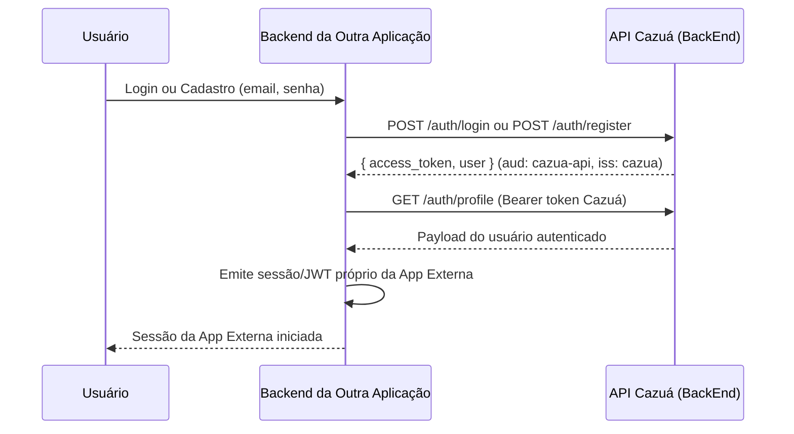

# Guia de Integração: API de Autenticação e Usuários (Cazuá)

Este documento descreve como aplicações externas podem consumir a API do Cazuá para autenticação, cadastro e gestão de usuários em organizações permitidas.

---

## 1. Visão Geral da Arquitetura

O Cazuá utiliza **JSON Web Tokens (JWT)** assinados com algoritmo HS256 (`issuer: "cazua"`, `audience: "cazua-api"`).

> **Aviso de Segurança (Arquitetura Recomendada):**
> **NÃO compartilhe o segredo `JWT_SECRET` com outras aplicações.** Quem possui este segredo pode assinar tokens arbitrários, inclusive com privilégios de Administrador Geral (`isSuperAdmin`).
> A aplicação externa deve autenticar seus usuários contra o backend do Cazuá e, em seguida, emitir **seu próprio token** (com seu próprio segredo e claims da sua regra de negócio) para suas sessões locais.



---

## 2. Credenciais de API Client (Aplicações Externas)

Para que a aplicação externa possa realizar **auto-cadastro de usuários vinculados a organizações pré-aprovadas**, ela deve possuir credenciais de servidor (`x-client-id` e `x-client-secret`).

### Obtenção de Credenciais
O Super Administrador cadastra a aplicação em:
- **Endpoint**: `POST /api-clients` (Protegido por Bearer JWT de Super Admin)
- **Campos**:
  - `name`: Nome legível da aplicação (aparece nos e-mails transacionais).
  - `allowedOrgIds`: Lista de ObjectIds das organizações nas quais a aplicação tem permissão de inserir membros.
  - `defaultRole`: Cargo atribuído por padrão aos usuários cadastrados (`MEMBER` ou `VIEWER`).
  - `ownerUserId`: (Opcional) Usuário do Cazuá que responde como OWNER da aplicação.
  - `resetPasswordUrl`: (Opcional) URL personalizada da tela de redefinição de senha na aplicação externa (ex: `https://app.outra.com/reset-password`). Se não informado, o link direciona para a tela neutra do Cazuá (`/recover`).

> O `clientSecret` é retornado **uma única vez** no momento da criação ou rotatividade (`POST /api-clients/:id/rotate-secret`). Guarde-o em cofre seguro de variáveis de ambiente no servidor da aplicação parceira.

---

## 3. Endpoints Principais

### A. Auto-Cadastro com Organização
- **Rota**: `POST /auth/register`
- **Headers Obrigatórios**:
  - `Content-Type: application/json`
  - `x-client-id: <seu-client-id>`
  - `x-client-secret: <seu-client-secret>`
- **Body**:
  ```json
  {
    "name": "Nome Completo",
    "email": "usuario@empresa.com",
    "password": "SenhaSegura123!",
    "orgId": "65f0a1b2c3d4e5f6a7b8c9d0"
  }
  ```
- **Comportamento**:
  - Se o e-mail não existir no Cazuá: cria a conta global e vincula o usuário à organização informada com o cargo padrão configurado para a aplicação (`linked: false`).
  - Se o e-mail já existir no Cazuá com as **mesmas credenciais**: apenas adiciona o vínculo à organização informada (`linked: true`).
  - Se o e-mail já existir com senha diferente: retorna `409 Conflict` (as tentativas contam para bloqueio contra brute-force).

### B. Login de Usuário
- **Rota**: `POST /auth/login`
- **Rate Limit**: 5 requisições por janela de 10 segundos.
- **Body**:
  ```json
  {
    "email": "usuario@empresa.com",
    "password": "SenhaSegura123!"
  }
  ```
- **Resposta (200 OK)**:
  ```json
  {
    "access_token": "eyJhbGciOiJIUzI1Ni..."
  }
  ```
- **Bloqueio Temporário**: Após 5 tentativas consecutivas incorretas, a conta é bloqueada por 60 minutos (retorna `401 Unauthorized`).

### C. Validação de Token / Obtenção de Perfil
- **Rota**: `GET /auth/profile`
- **Header**: `Authorization: Bearer <access_token>`
- **Resposta (200 OK)**:
  ```json
  {
    "sub": "65f0a1b2c3d4e5f6a7b8c9d0",
    "name": "Nome do Usuário",
    "email": "usuario@empresa.com",
    "isSuperAdmin": false,
    "iss": "cazua",
    "aud": "cazua-api",
    "iat": 1729500000,
    "exp": 1729586400
  }
  ```

### D. Recuperação de Senha
- **Rota**: `POST /users/forgot-password`
- **Headers Opcionais** (para contextualizar com a aplicação externa):
  - `x-client-id: <seu-client-id>`
  - `x-client-secret: <seu-client-secret>`
- **Body**:
  ```json
  {
    "email": "usuario@empresa.com"
  }
  ```
- O e-mail transacional é enviado com menção à aplicação externa e direciona o usuário para o endereço configurado no cadastro do API Client ou para a tela neutra `/recover?token=...`.

---

## 4. Documentação Interativa (Swagger)

A documentação interativa da API está disponível em:
- **Swagger UI**: `GET /api`
- **OpenAPI 3.0 Spec JSON**: `GET /api-json`

Em ambientes de produção com `SWAGGER_USER` e `SWAGGER_PASSWORD` configurados, a documentação é protegida por **HTTP Basic Authentication**.
